<div align="center">

<a href="https://github.com/ishandutta2007/Awesome-Collaborative-Debugging-Live-Sharing">
  
</a>

# ⚡ Awesome Collaborative Debugging & Live Sharing 🚀

[](https://github.com/ishandutta2007/Awesome-Awesome-Awesome)<a href="https://discord.gg/jc4xtF58Ve"></a>
[](https://github.com/ishandutta2007/Awesome-Collaborative-Debugging-Live-Sharing)
[](https://github.com/ishandutta2007/Awesome-Collaborative-Debugging-Live-Sharing/pulls)
[](https://github.com/ishandutta2007/Awesome-Collaborative-Debugging-Live-Sharing/graphs/commit-activity)
[](LICENSE)
<a href="https://github.com/ishandutta2007"></a>

**A meticulously curated list of premier SaaS platforms, self-hosted web IDEs, shared terminal multiplexers, and open-source developer tools for real-time remote pair programming, synchronous code reviews, and multiplayer collaborative debugging.**

*Eliminate screen-sharing latency and video conferencing friction with hands-on, live multi-cursor code synchronization, terminal sharing, and shared runtime debuggers.*

</div>

---

## 📑 Table of Contents

- [📊 Sector Overview & Market Dynamics](#-sector-overview--market-dynamics)
- [☁️ SaaS & Hosted Platforms](#-saashosted-platforms)
- [🔓 Open-Source GitHub Projects](#-open-source-github-projects)
- [🛠️ Architectural Patterns & Custom Stacks](#️-architectural-patterns--custom-stacks)
- [🤝 How to Contribute](#-how-to-contribute)
- [💖 Support & Sponsorship](#-support--sponsorship)
- [📈 Star History](#-star-history)
- [⚠️ Disclaimer](#️-disclaimer)

---

## 📊 Sector Overview & Market Dynamics

The global collaborative development, debugging, and AI pair-programming software sector represents an estimated **$10.6B+ to $19.5B addressable market** (spanning developer tooling, automated software debugging at ~$2.8B, and AI-accelerated code assistance expanding at a ~24–27% CAGR towards $45B+ by 2032).

Market concentration displays a **distinct bifurcated hybrid dynamic**: the core IDE ecosystem is **highly concentrated** among platform titans (Microsoft VS Code/Visual Studio and JetBrains) acting as primary distribution gates, while the surrounding specialized layer—comprising real-time CRDT synchronization engines, encrypted terminal relays, browser microVMs, and multi-agent AI pair-programming workspaces—remains **moderately fragmented** with high startup velocity and vibrant open-source alternatives competing to prevent vendor lock-in.

---

## ☁️ SaaS/Hosted Platforms

| Product | Company Size / Valuation / Revenue | Starting Tier Pricing | Free Tier / Trial Limits | Description |
|:---|:---|:---|:---|:---|
| **[AWS Cloud9](https://aws.amazon.com/cloud9/)** | Market Cap: ~$2.1T+ / Annual Revenue: $600B+ (Amazon / AWS segment ~$105B+ ARR) | Pay-as-you-go based on underlying EC2 compute (starting at ~$0.0104/hr for t4g.nano or ~$2.00/month for minimal usage; Cloud9 IDE service itself has no additional fee) | **Free forever via AWS Free Tier**: 750 hours/month of t2.micro or t3.micro EC2 compute + 30 GB EBS storage for first 12 months; IDE environment itself has no per-seat charge | 🌐 Browser-based IDE with built-in terminal, debugger, and real-time collaboration. Share your development environment with teammates for pair programming. Pay only for the underlying EC2 resources; the IDE itself is free. |
| **[Visual Studio Live Share](https://visualstudio.microsoft.com/services/live-share/)** | Market Cap: ~$3.1T+ / Annual Revenue: $245B+ (Microsoft) | $0 (included free with Visual Studio and VS Code; Visual Studio Professional starts at $45/user/month for commercial IDE licensing) | **Free forever**: Full collaborative session and debugging features available at no cost for all VS Code and Visual Studio users (requires Microsoft or GitHub account login) | 💻 Microsoft's real-time collaborative coding and debugging tool. Host shares their entire project (code, terminal, localhost web app) without guests needing to install dependencies. Supports shared debugging sessions, voice calls, and read-only mode. In maintenance mode with existing capabilities retained. |
| **[JetBrains (Code With Me)](https://www.jetbrains.com/code-with-me/)** | Valuation: ~$5B–$9B (est.) / Annual Revenue: ~$650M+ (JetBrains) | $10/user/month (annual: $100/user/year; also included in JetBrains All Products Pack subscriptions) | **Free tier available**: Unlimited sessions capped at 30 minutes maximum per session and up to 3 guest collaborators per session; paid plans unlock unlimited session duration and up to 50 guests | 👥 JetBrains' collaborative coding and pair-programming service for IntelliJ-based IDEs. Invite others into your IDE project for real-time editing and debugging. Guests can join via browser or lightweight client without a local IDE installation. |
| **[Replit](https://replit.com/)** | Valuation: $9.0B (Series D, 2026) / Annual Revenue: ~$300M–$500M+ run-rate | Replit Core: $20/month ($204/year billed annually); Replit Pro: $100/month | **Free Starter plan forever**: Includes basic real-time multiplayer editing, daily AI Agent trial prompts, public Repls, and 10 compute units/month (no credit card required) | 🚀 Browser-based IDE with real-time multiplayer editing (Google Docs-style). Invite teammates directly into your code environment with zero setup. Supports 50+ languages and instant live deployment. |
| **[CodeSandbox](https://codesandbox.io/)** | Valuation: ~$50M–$100M (Acquired by Together AI) / Annual Revenue: ~$1.5M–$1.9M ARR | Pro Plan: $12/user/month ($144/user/year billed annually) | **Free Build plan forever**: Up to 5 team members per workspace, unlimited public sandboxes, up to 10 concurrent microVMs, and standard baseline microVM compute (1 vCPU, 1 GB RAM) | 📦 Cloud development platform with live collaboration, microVMs, and AI assistant (Boxy). Teams can code together in a shared browser environment with instant preview and deployment. |
| **[Tuple](https://tuple.app/)** | Valuation: ~$20M–$40M (est. bootstrapped) / Annual Revenue: ~$4M–$8M ARR | $30/user/month ($300/user/year billed annually) | **14-day free trial**: Full access to all pairing features, multi-cursor support, low-latency screen control, and unlimited session duration (free sponsored licenses available for qualifying OSS maintainers) | ⚡ Purpose-built remote pair programming tool for macOS and Windows. Low-latency screen sharing optimized for coding, remote control, and crystal-clear text rendering. Only host requires a paid seat; guests can join for free. |
| **[Tandem](https://tandem.chat/)** | Valuation: ~$20M–$35M (est.) / Annual Revenue: ~$1.9M ARR ($8.8M VC raised) | Small Teams Plan: $49/month (or $499/year billed annually for teams up to 10 members) | **Free tier forever**: Up to 4 team members with unlimited drop-in audio huddles, screen sharing with live multi-cursors, and shared application controls | 🏢 Virtual office for remote teams with instant screen sharing, shared cursors, remote control, and drop-in audio/video rooms. Positioned as a persistent virtual workspace for spontaneous pair programming and debugging. |

---

## 🔓 Open-Source GitHub Projects

Below are the most prominent community-driven and self-hosted open-source projects for collaborative debugging, shared terminal sessions, and live pair programming—sorted in descending order by GitHub_Stars_Count:

| Project | Stars_Count | Primary Focus | Description |
|:---|:---|:---|:---|
| **[GoTTY](https://github.com/yudai/gotty)** | [](https://github.com/yudai/gotty/stargazers) | Terminal to Web Bridge | 🌐 Simple Golang command-line tool that turns your CLI tools and terminal sessions into a live web application, allowing remote peers to view or write to your shell over WebSockets. |
| **[ttyd](https://github.com/tsl0922/ttyd)** | [](https://github.com/tsl0922/ttyd/stargazers) | High-Performance Web Terminal | ⚡ C-based lightweight terminal sharing daemon over the web with WebSockets, SSL, and full CJK / IME terminal input support for live terminal pairing. |
| **[sshx](https://github.com/ekzhang/sshx)** | [](https://github.com/ekzhang/sshx/stargazers) | Collaborative Infinite-Canvas Terminal | 🎮 Ultra-fast web-based collaborative terminal built with Rust and WebAssembly. Provides multi-cursor presence, canvas panning, and instant encrypted terminal sharing with a single CLI command. |
| **[tmate](https://github.com/tmate-io/tmate)** | [](https://github.com/tmate-io/tmate/stargazers) | Terminal Multiplexer Sharing | 📟 Instant terminal sharing fork of tmux. Spawns an encrypted SSH session with dedicated read-write and read-only URLs for instant collaborative terminal debugging. |
| **[JS Bin](https://github.com/jsbin/jsbin)** | [](https://github.com/jsbin/jsbin/stargazers) | Collaborative Web Debugger | 🛠️ Open-source web development collaborative sandbox designed specifically to test, debug, and share snippets of JavaScript, CSS, and HTML with real-time rendering. |
| **[Upterm](https://github.com/owenthereal/upterm)** | [](https://github.com/owenthereal/upterm/stargazers) | Secure SSH / WebSocket Terminal | 🔒 Secure terminal sharing utility over SSH and WebSockets. Host sessions and share encrypted connection links; peers connect via native SSH client without local configuration. |
| **[live-share.nvim](https://github.com/azratul/live-share.nvim)** | [](https://github.com/azratul/live-share.nvim/stargazers) | Neovim Real-Time Live Share | 💻 Real-time pair programming and collaborative editing plugin natively designed for Neovim, inspired by VS Code Live Share with synchronized cursors and Instant-Join features. |
| **[Floobits (Sublime)](https://github.com/Floobits/floobits-sublime)** | [](https://github.com/Floobits/floobits-sublime/stargazers) | Multi-Editor Live Pair Programming | ✍️ Cross-editor collaborative editing plugin integrating Sublime Text with live cursors, highlights, and real-time bidirectional diff synchronization across distributed team members. |
| **[Tessera](https://github.com/Kushaal-k/Tessera)** | [](https://github.com/Kushaal-k/Tessera/stargazers) | Browser Sandbox & Docker Runner | 🧪 Collaborative developer sandbox with Monaco editor, shared files, and interactive terminal. Real-time collaboration powered by Yjs CRDTs and Socket.IO with Docker runtime execution. |
| **[Debugra](https://github.com/vijaypatil477/Debugra)** | [](https://github.com/vijaypatil477/Debugra/stargazers) | Real-time Multi-Language Debugger | 🔍 Collaborative debugging platform with real-time code sharing via Firebase, AI-assisted debugging (Groq), Wandbox multi-language execution, and VS Code-style interface. |
| **[Collagility](https://github.com/JhaSourav07/Collagility)** | [](https://github.com/JhaSourav07/Collagility/stargazers) | Multiplayer AI Terminal Workspace | 🤖 Multiplayer terminal workspace for collaborative AI pair programming with token-by-token streaming and a multi-level execution security verification engine. |

---

## 🛠️ Architectural Patterns & Custom Stacks

For engineering teams seeking to eliminate third-party SaaS dependency or enterprise compliance blockers, open-source building blocks can be assembled into sovereign internal pairing platforms:

```text
┌────────────────────────────────────────────────────────┐
│               Collaborator Client Tier                 │
│    (Browser Monaco / Neovim / Native Terminal SSH)     │
└──────────────┬──────────────────────────┬──────────────┘
               │                          │
      WebSocket / CRDT Relay      Encrypted P2P / SSH
               │                          │
┌──────────────▼──────────────┐ ┌─────────▼──────────────┐
│  State Sync & Editor Layer  │ │  Interactive Terminal  │
│  • Tessera (Yjs / Monaco)   │ │  • sshx / tmate        │
│  • live-share.nvim          │ │  • Upterm / ttyd       │
└──────────────┬──────────────┘ └─────────┬──────────────┘
               │                          │
┌──────────────▼──────────────────────────▼──────────────┐
│       Isolated Execution & Debugging Runtime           │
│   (Docker Containers / Firecracker microVMs / Wandbox) │
└────────────────────────────────────────────────────────┘
```

- **Browser Pair-Programming Suite**: Combine **Tessera** (Yjs CRDTs + Monaco) with containerized Docker sandboxes.
- **Terminal Pair-Debugging Setup**: Use **sshx** for browser-based visual terminal canvas collaboration, or **tmate** / **Upterm** for pure SSH terminal pairing across CLI environments.
- **AI-Augmented Co-Debugging**: Integrate **Collagility** or **Debugra** for live shared multi-model AI agent debugging with safety gates.

---

## 🤝 How to Contribute

Contributions are welcome! To propose new entries or updates:

1. 🍴 **Fork** the repository.
2. 🌿 Create your feature branch (`git checkout -b feature/add-new-tool`).
3. 📝 Update `README.md` keeping entries factually accurate, structured in the proper table format, and alphabetically or quantitatively sorted.
4. 🚀 Commit your changes (`git commit -m "Add ToolName to collaborative tools list"`).
5. 📤 Push to the branch (`git push origin feature/add-new-tool`).
6. 🔀 Open a **Pull Request**.

---

## 💖 Support & Sponsorship

If you find this curated list valuable for your remote engineering workflows, pair-programming setups, or open-source research, please consider supporting the project:

- ⭐ **Star this repository** to help others discover it!
- 🍴 **Fork and share** with your teammates, mentors, and developer communities.
- ☕ **Buy a coffee & sponsor**: Support active maintenance and continuous updates on the [**GitHub Sponsors Dashboard**](https://github.com/sponsors/ishandutta2007).

---

## 📈 Star History

[](https://www.star-history.com/#ishandutta2007/Awesome-Collaborative-Debugging-Live-Sharing&type=date&legend=top-left)

---

## ⚠️ Disclaimer

- This is an independent, community-curated list maintained for educational and architectural reference—not an endorsement or financial advisory.
- Live collaborative debugging tools grant remote visibility and execution capabilities to code and infrastructure; always enforce strict authentication, zero-trust network policies, role-based access control, and read-only modes where appropriate.
- Product pricing, tier limits, and valuations fluctuate; verify with vendor documentation before making procurement decisions.

---

<div align="center">
  <b>Built with ❤️ for remote developers, engineering mentors, pair programmers, and distributed teams worldwide.</b>
</div>
